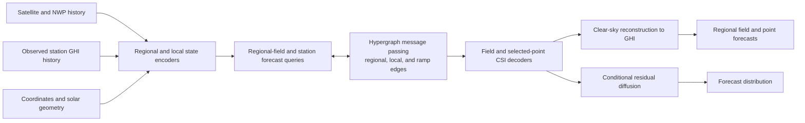

# HyperSolar

HyperSolar is a research codebase for **solar irradiance forecasting at both regional-field and selected-site scales**. The repository contains model code for the V1–V9 design family, a four-dataset data adapter, training utilities, and a separate high-cost 128×128 SolarCube experiment. The prediction target is irradiance (GHI/clear-sky index), not PV power.

We study how deterministic spatiotemporal representations, cloud/ramp state, residual diffusion, and hypergraph message passing can be combined for joint field-and-point forecasting. The model registry is intended to make these design choices explicit; reported results must always be tied to the exact dataset adapter, target definition, split, grid, and checkpoint used.

## Architecture

The current four-dataset training adapter implements a V9 Ramp-HG model. In brief, aligned satellite/NWP/context features and observed irradiance histories form the input state; regional and local representations are used to produce forecast queries; hypergraph interactions exchange information across regional and station nodes; and a conditional residual diffusion branch represents forecast uncertainty. Clear-sky geometry is used to form CSI-based predictions and reconstruct GHI.



The diagram summarizes the adapter's model flow; individual version files may implement only a subset of these components.

## Model versions

| Version | Main design | Source |
|---|---|---|
| V1 | Deterministic field/point backbone with residual-diffusion components | `code/models/v1_v2_station_models.py`, `code/models/field_point_versions.py` |
| V2 | Joint radiative-state/CSI and irradiance forecasting with a field/point backbone | `code/models/train_v2_csi_joint.py`, `code/models/train_v2_field_point.py` |
| V3 | Vision-Swin spatial encoder variant | `code/models/encoder_registry.py` |
| V4 | Residual-convolution plus ViT encoder variant | `code/models/encoder_registry.py` |
| V5 | Residual-convolution, Swin local stages, and global ViT interaction | `code/models/encoder_registry.py` |
| V6 | Validation-fitted clear-sky/SMF forecast fusion gate | `code/models/v6_clear_sky_gate.py` |
| V7 | Regional/local cloud and ramp features with bidirectional field/point refinement | `code/models/train_v7_branch7.py` |
| V8 | V3-style encoder with diffusion residuals fed into message refinement | `code/models/train_v8_diffusion_message.py` |
| V9 | Hypergraph field/point information exchange with conditional residual diffusion; Ramp-HG adds observed-history ramp conditioning | `code/models/v9_cloudstate_hypergraph.py`, `code/models/v9_ramp_hyperedge.py` |

V3–V5 are encoder choices in a shared registry, not three independent end-to-end pipelines. The version files are research implementations; they do not all share a single validated four-dataset training entry point. The runnable four-dataset adapter described below is specifically the V9 Ramp-HG experiment.

## Datasets

The loader in `code/four_dataset_code/data.py` supports adapters for:

- **CN-Solar** — gridded solar/meteorological records from the configured archive.
- **NSRDB** — irradiance field and selected-point records from the configured archive.
- **SolarAlabama** — station/field adapter using the configured CERES-derived irradiance proxy; this proxy is not station-measured GHI or plant power.
- **SolarCube** — satellite/NWP and irradiance products prepared through the SolarCube adapter and site list.

The archive layouts, variables, masks, and defaults are documented in `code/four_dataset_code/data.py` and `code/four_dataset_code/prepare_cube.py`. Dataset targets are not interchangeable; check each adapter's metadata before comparing scores. Dataset archives and trained weights are not included in this repository.

Set local paths with environment variables rather than editing source files:

```bash
export HYPERSOLAR_DATA_DIR=/path/to/data
export HYPERSOLAR_CACHE_DIR=/path/to/cache
export HYPERSOLAR_CNSOLAR_ARCHIVE=/path/to/cn_solar.npz
export HYPERSOLAR_NSRDB_ARCHIVE=/path/to/nsrdb.npz
export HYPERSOLAR_SOLARALABAMA_ARCHIVE=/path/to/solar_alabama.npz
export HYPERSOLAR_SOLARCUBE_SITELIST=/path/to/solarcube_sitelist.csv
```

For a full SolarCube run, set `HYPERSOLAR_SOLARCUBE_WARMSTART` to the approved training/validation-only backbone checkpoint required by the adapter. Never use test labels to build preprocessing statistics or warm-start weights.

## Running an experiment

Create a Python environment with PyTorch, CUDA, NumPy, SciPy, pandas, and pvlib installed. From the repository root, configure the data paths above and run a smoke check on one dataset:

```bash
cd code/four_dataset_code
python train.py --dataset CN-Solar --batch 8 --smoke
```

Run a single dataset with early stopping:

```bash
python train.py --dataset CN-Solar --batch 8 --epochs 60 --patience 8
```

Run the supported datasets sequentially on one selected GPU:

```bash
python launch.py --gpu 0 --datasets CN-Solar NSRDB SolarAlabama SolarCube --batch 8
```

The launcher performs a smoke run before full training for each dataset and stops if a smoke check or training job fails. Outputs are written under `HYPERSOLAR_CACHE_DIR/results/<dataset>/`; queue logs and state are written under `HYPERSOLAR_CACHE_DIR/queue/`.

## Hyperparameters

The four-dataset V9 Ramp-HG adapter uses the following defaults:

| Setting | Default |
|---|---:|
| Random seed | 42 |
| History / forecast horizon | 72 / 24 hours |
| Hidden width / attention heads | 64 / 4 |
| Maximum epochs / early-stopping patience | 60 / 8 (minimum 5 epochs) |
| Batch size | 8 |
| Optimizer | AdamW, learning rate 1e-4, weight decay 1e-5 |
| Gradient clipping | 1.0 |
| Diffusion steps / ensemble members | 8 / 8 |
| Split | Chronological 70% / 15% / 15% |

Training windows are kept within their chronological split. Normalization is fitted on training data only. For controlled comparisons, keep the dataset version, valid-label mask, target scale, spatial grid, forecast origins, and random seed fixed across models.

## SolarCube 128×128 experiment

`code/solarcube_grid128/` contains a separate V9 Ramp-HG large-grid experiment. It maps model inputs to a 128×128 computational grid, while the available target labels remain on the native 120×120 grid. Predictions are mapped back to native resolution for supervision and scoring; this does not create new 128×128 observations.

```bash
export HYPERSOLAR_REGISTRY_DATA=/path/to/solarcube_inputs
export HYPERSOLAR_NATIVE120_DATA=/path/to/native120_cache
export HYPERSOLAR_SOLARCUBE_PREPARED=/path/to/solarcube_prepared
export HYPERSOLAR_SOLARCUBE_SITELIST=/path/to/site_list.csv
python code/solarcube_grid128/train_v9_ramp_hg128.py --out /path/to/output
```

See `code/solarcube_grid128/README.md` for the grid preparation and plotting details.

## Reproducibility and outputs

Each run should retain its configuration, source revision, training log/history, early-stopping decision, best checkpoint, test truth/prediction archive, metrics, and figures. The current four-dataset trainer optimizes joint field-and-point CSI/GHI losses with a diffusion loss, but its test-evaluation archive and reported metrics currently cover the selected point only; field test metrics/predictions need a matching evaluator before claiming field-level test results. It writes `config.json`, `training_history.json`, `metrics.json`, `test_predictions.npz`, and `DONE.json` in the dataset result directory. Do not compare a run unless its test split and target protocol match the reference.

The 128×128 outputs are computational-grid predictions evaluated against native-grid observations. Randomly initialized encoder adaptations are not pretrained reproductions of the corresponding external methods. Results and pretrained weights are not bundled; cite the exact run configuration and checkpoint when reporting scores.